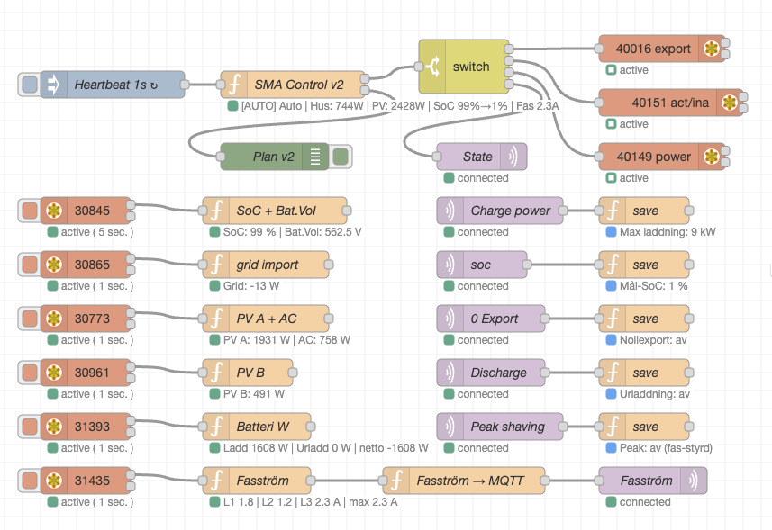

# SMA Inverter &amp; Battery Control (Node-RED Flow)

A Node-RED flow that controls an **SMA Tripower inverter** with a **BYD battery** over **Modbus TCP**, and takes its commands over **MQTT**. You tell it what you want (for example "charge the battery to 80 %" or "never take more than 11 kW from the grid") and the flow works out what the inverter should do, second by second.

> **Inspiration:** This project was inspired by and built upon concepts from [condacum/SMA-Modbus-energy-management-system](https://github.com/condacum/SMA-Modbus-energy-management-system).

I've removed my system from SMA portal to secure no interference from them. I've also blocket all attempt from the inverter, and Home Manager 2, to call home. If you remove your system from SMA portal be aware that you will lose all your data and you'll not receive any alarms generated from the inverter, this includes alarm of residual current! Make sure you're following your local regulations. In my case I pick up these alarms with Home Assistant.

I've only tested this with SMA Tripower Smart Engergy 8 SE and BYD HVS batteries. Please read the MIT license prior to use this code!

## Features

### How it works, in short

Every second the flow:

1. **Reads** the inverter: solar power (string A and B), the inverter's AC output, battery power and state of charge (SoC), grid import/export and the current on each of the three phases.
2. **Works out** how much power the house is using: *what the inverter delivers + what comes from the grid*. No extra energy meter is needed.
3. **Decides** which mode the system should be in (see below), based on your MQTT settings and the measurements.
4. **Tells** the inverter what to do, but only when something actually changes, so the inverter is not flooded with writes.
5. **Publishes** the current mode and the phase currents on MQTT, for example to Home Assistant.

In my case all decision making is done in Home Assistant. This flow just carries out the commands and keeps the system safe.

### Safety built in

- **Fail-safe:** every measurement has a time stamp. If an important value (SoC, grid, solar or inverter output) is missing or older than 10 seconds, the flow stops controlling and hands the inverter back to its own built-in control.
- **Main fuse protection:** the flow watches the current on each phase. If a phase gets close to the main fuse (20 A), the battery steps in so the fuse does not blow. When charging, the charge power is lowered instead.
- **Inverter limits:** the flow never asks for more than the inverter can deliver (8 kW AC in total, shared between solar and battery).
- **Calm switching:** a mode is kept for at least 20 seconds before the flow changes to another one, so it does not jump back and forth (peak shaving and fail-safe react immediately).

### Dynamic Operational Modes

The flow is always in exactly one of these modes. The current mode is published on `sma/state`.

- `AUTO`**:** The inverter runs on its own normal self-consumption logic: solar surplus charges the battery, and the battery covers the house when the sun is not enough. Used when the battery is above your target SoC.
- `CHARGE`**:** The battery is charged until it reaches your target SoC, from solar and, if needed, from the grid. The charge power is the lowest of: your limit (`sma/chargepower`), what the inverter can take, the peak limit and the fuse limit.
- `LOCKED`**:** The battery is held still, neither charged nor discharged. The house runs on solar and grid. Used when the battery is exactly at your target SoC and there is no solar surplus, so the battery is saved for later.
- `ZERO_EXPORT`**:** Nothing is sold to the grid. The inverter's output is limited to what the house uses, and the battery helps cover the house. Turned on with `sma/zeroexport`.
- `PEAK_SHAVING`**:** The battery discharges to keep grid import below your peak limit (`sma/peak`, default 13 kW) and each phase below the fuse limit. It only covers the part above the limit and never pushes power out to the grid. The power limit is paused when the battery is below 5 % (back at 7 %); the fuse protection always works.
- `DISCHARGE_MANUAL`**:** The battery covers the house and also sells the amount you set with `sma/discharge` to the grid, for example when the electricity price is high. Stops by itself when the battery reaches your target SoC.
- `FAILSAFE`**:** Important measurements are missing or too old. The inverter is handed back to its own control (same behaviour as `AUTO`) until the data is back.

**Which mode wins?** If several modes could apply, the first one in this list is chosen:

`FAILSAFE` → `PEAK_SHAVING` → `DISCHARGE_MANUAL` → `ZERO_EXPORT` → `CHARGE` → `AUTO` / `LOCKED`

When the battery is exactly at the target SoC, the flow switches from `LOCKED` to `AUTO` once there has been solar surplus for 10 seconds, and back to `LOCKED` after 60 seconds without surplus. This avoids constant switching on cloudy days.

## External Sensor &amp; Hardware Requirements

To run this flow effectively, your setup requires the following hardware:

- **SMA Solar Inverter:** An SMA Tripower inverter with Modbus TCP enabled (default Unit ID `3`). The flow reads solar, battery and grid values from it and writes the control commands to it.
- **SMA Home Manager 2:** Measures the power and the phase currents at the grid connection. The inverter passes these values on to the flow, and the inverter's own `AUTO` mode depends on it.
- **BYD Battery Storage System:** Connected to the SMA inverter for energy storage.
- **A 24/7 server with Node-RED installed**. I run it on a Debian LXC container operating on a Proxmox server.

No external energy meter is needed any more (version 1.0 used a Shelly EM3).

## MQTT Commands &amp; Topics

You control the system by publishing messages to these MQTT topics. The flow remembers the last value you sent.

**Settings you send:**

- `sma/soc`
  - *What it does:* The battery level you want, in % (default `50`).
  - Battery below the target → `CHARGE`. Battery above the target → `AUTO`. Battery exactly at the target → `LOCKED` (or `AUTO` when there is solar surplus).
- `sma/chargepower`
  - *What it does:* The highest charge power in kW (default `5`, maximum `9`). The battery can handle 10 kW, but I limit it to 9 kW to spare the electronics.
- `sma/zeroexport`
  - *What it does:* `1` = never sell power to the grid (`ZERO_EXPORT`), `0` = normal. I use this when the electricity price is negative and my battery is full.
- `sma/peak`
  - *What it does:* The most power, in W, that you want to take from the grid (for example `11000`). The battery covers anything above this. `0` or not set = 13 kW. Useful if you pay a power tariff.
- `sma/discharge`
  - *What it does:* How much power, in W, you want to sell to the grid from the battery (`DISCHARGE_MANUAL`). Values below 2500 W count as off, maximum 8000 W. Only works while the battery is above `sma/soc`. Send `0` to stop.

**Values the flow publishes:**

- `sma/state`
  - The current mode: `AUTO`, `CHARGE`, `LOCKED`, `ZERO_EXPORT`, `PEAK_SHAVING`, `DISCHARGE_MANUAL` or `FAILSAFE`. Sent as a retained message, so a new subscriber gets it straight away.
- `sma/fas/l1`, `sma/fas/l2`, `sma/fas/l3`
  - The current on each phase in A, every second. Handy for a Home Assistant sensor.
  - The standard SMA integration in Home Assistant only reads these values every 5 seconds. This flow publishes them every second, so Home Assistant can react sooner, for example to a phase getting close to the main fuse.

## Prerequisites &amp; Dependencies

- **Node-RED** with the following plugin installed:
  - `node-red-contrib-modbus`
- An active **MQTT Broker** (e.g., Eclipse Mosquitto).

## Setup &amp; Configuration

1. **Import:** Import `SMA-Control-v2.json` into Node-RED via **Import -&gt; Clipboard** (or **Select a file to import**).
2. **Modbus Client:** Open the `SMA tripower` Modbus configuration node and enter your inverter's IP address and port (`502`).
3. **MQTT Broker:** Open the `MQTT` broker configuration node and enter your broker's IP address and port (`1883`).
4. **Check your limits:** At the top of the `SMA Control v2` function node there is a list of constants (inverter size, max charge power, main fuse size and so on). Change them if your system differs from mine (STP 8.0 SE, 20 A main fuse).
5. **Deploy**, then send at least `sma/soc` so the flow knows your target.

The `Plan v2` debug node shows what the flow has decided and why, which is useful when you set it up.

`Node Red Flows 1.0 Beta.json` is kept for reference only. Never run version 1 and version 2 at the same time, since both would control the inverter.

## Versions

**2.0.0** (current, `SMA-Control-v2.json`)

- Peak shaving (grid power and main fuse), manual discharge to the grid, fail-safe on missing data and phase currents on MQTT. No Shelly meter needed.
- See [CHANGELOG.md](CHANGELOG.md) for all details.
- To go back to the old flow: disable the v2 tab, enable the old one and do a **full** deploy.

**1.0 Beta1** (`Node Red Flows 1.0 Beta.json`)

This release ran for some months without any issues.

**Roadmap**

- ~~Peak shaving~~ (done in 2.0.0).

## Node-RED view

&nbsp;
